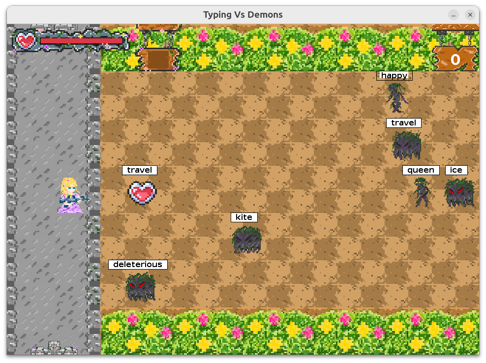
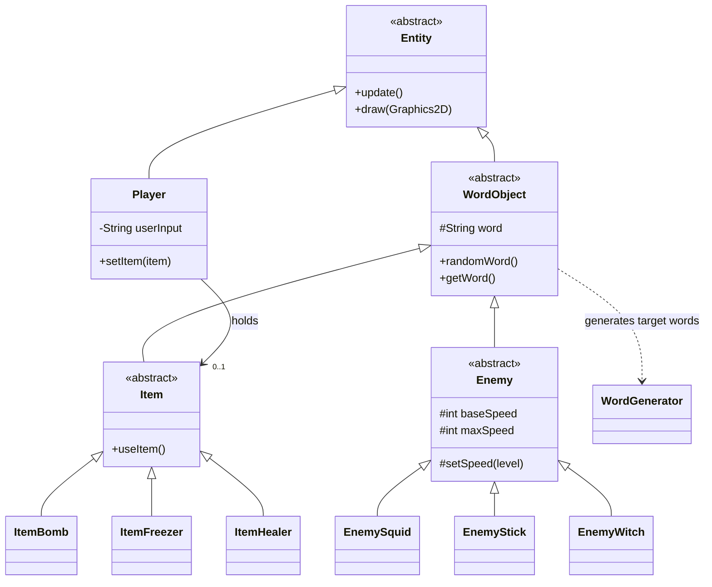
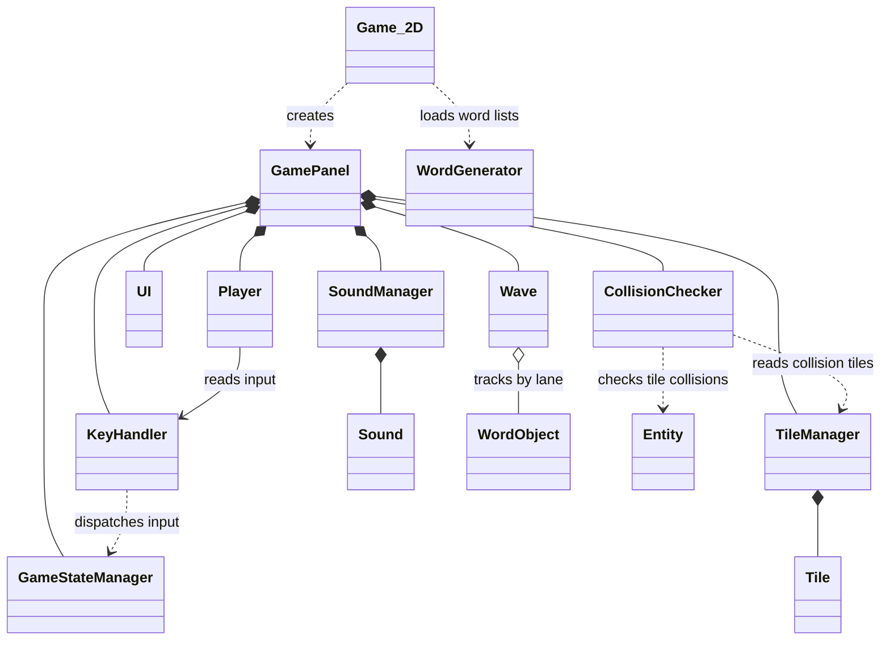
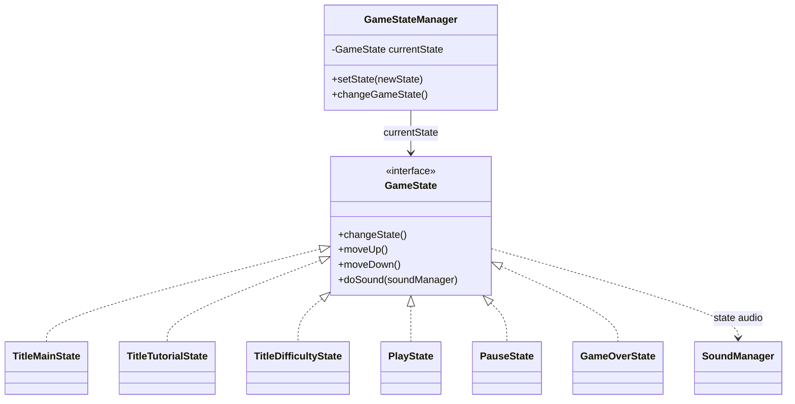
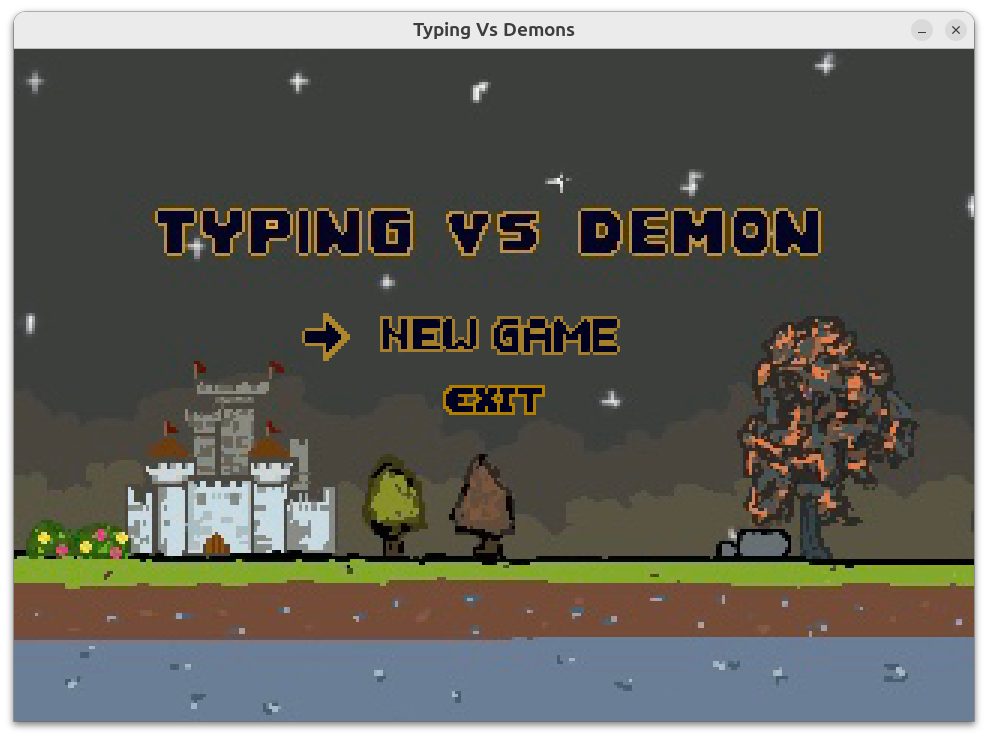
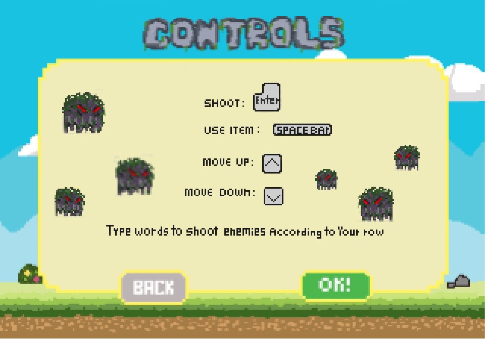
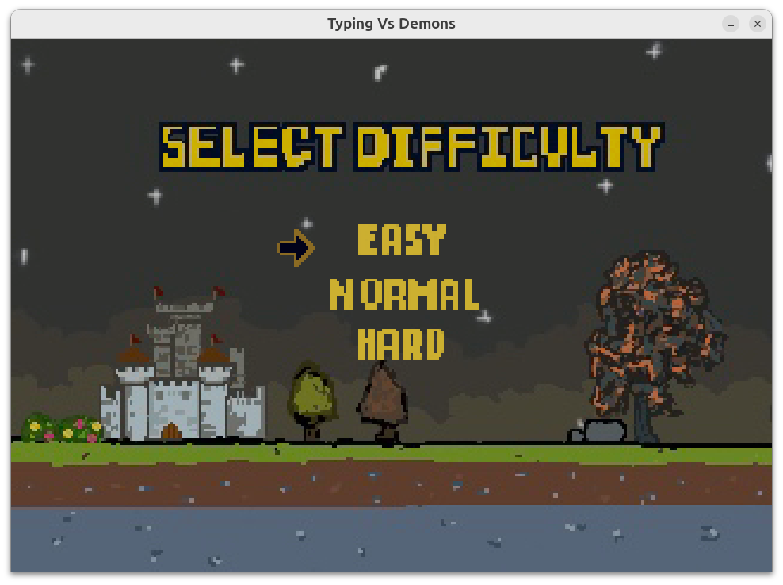
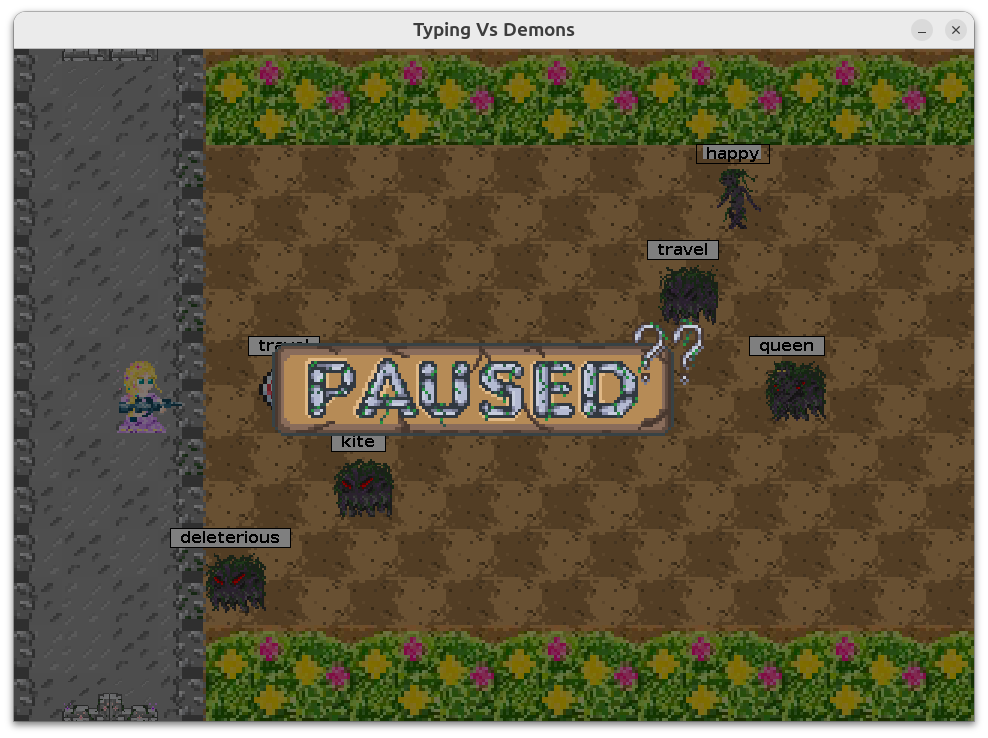
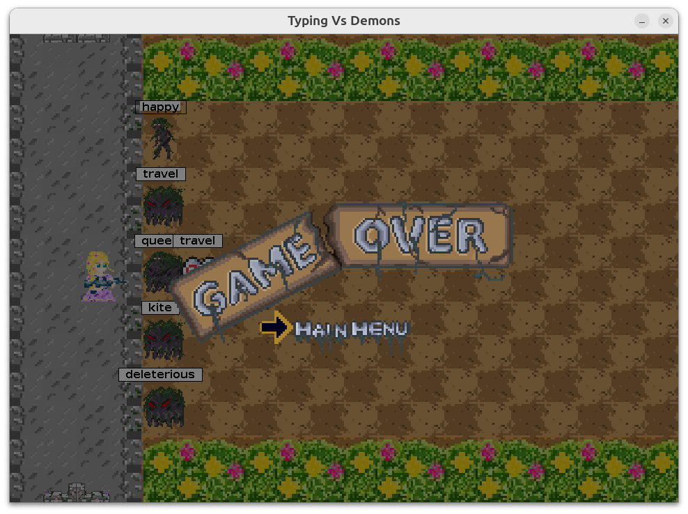

# Typing VS Demon

A Java typing survival game where players switch between five lanes and type words to defeat approaching demons. Survive endless waves and collect healing, freezing, and bomb items to defend the kingdom.

**Java 17 · Swing/AWT · Five-person team**

**Original course project: Feb–Mar 2025**

204114 Object Oriented Programming with Java, [Computer Science, Chiang Mai University](https://www.cs.science.cmu.ac.th/), Thailand.



## Why We Built It

The project began with an interest in combining typing practice with the story, feedback, and pressure of a survival game. Players take the role of a princess defending her kingdom, typing words to stop demons before they reach her.

We chose a 2D game as a practical way to apply Java OOP concepts to interacting systems. Development continued after the original course project, including refinements to the game and a later browser adaptation.

## Gameplay

- Move between five lanes and type a target word to defeat an enemy or collect an item.
- Survive increasingly large waves; enemy speed increases up to a cap for each enemy type.
- Choose Easy, Medium, or Hard to change progression parameters and word-selection probabilities.
- Use healing, freezing, and bomb items to survive longer.
- View score and health, pause gameplay, and restart after game over.

| Key | Action |
| --- | --- |
| Up / Down | Move between lanes; navigate menus |
| Letters, then Enter | Submit a word |
| Backspace | Remove the last typed letter |
| Space | Use the collected item |
| Esc | Pause or resume gameplay |

## Software Design

| System | Design |
| --- | --- |
| Entities | `Entity` holds shared entity state; `WordObject` adds target-word generation and label rendering for enemies and items. |
| Items | Concrete items implement `useItem()` to provide healing, freezing, and bomb effects through one activation method. |
| Game states | A `GameState` interface and state manager organize screen behavior and transitions. |
| Waves | Objects are grouped by lane; the wave manager coordinates word matching, spawning, and progression. |
| Map and collision | A text-based tile grid supplies both the map's appearance and movement-blocking properties. |
| Rendering | The game loop updates gameplay and draws to an offscreen image before displaying the frame. |

We used class diagrams to discuss responsibilities and agreed on tile dimensions before artwork production, giving programmers and artists a shared specification.

### Class Relationships

These diagrams show selected relationships and members from the current Java
implementation. Standard-library classes and most references back to `GamePanel`
are omitted for readability.

#### Gameplay entities



<details>
<summary>Application components</summary>



`GamePanel` owns and coordinates the main components. `Wave` tracks enemies and
items through their shared `WordObject` type.

</details>

<details>
<summary>Game-state classes</summary>



Each concrete state implements `GameState` and holds a reference to the manager
for transitions. Some transitions also originate in `KeyHandler` and `Player`.

</details>

Triangles represent inheritance or interface implementation. Filled diamonds
represent ownership, open diamonds represent aggregation, and arrows represent
references or dependencies.

## Build and Run

### From the command line

Requirements: JDK 17 or newer and either Bash or PowerShell 7 (`pwsh`).

Clone the repository:

```sh
git clone https://github.com/Cellul4r/typing_vs_demon_game.git
cd typing_vs_demon_game
```

**Bash (Linux, macOS, WSL, or Git Bash):**

```bash
bash scripts/build-web.sh
java -jar build/cheerpj/site/Game_2D.jar
```

**PowerShell:**

```powershell
pwsh -File scripts/build-web.ps1
java -jar build/cheerpj/site/Game_2D.jar
```

Both scripts create the same game JAR and browser assets. If the build cannot find
the JDK, set `JAVA_HOME` or pass the JDK directory with `--java-home` (Bash) or
`-JavaHome` (PowerShell). In WSL, use a JDK installed inside the Linux environment.

### With Apache NetBeans

Open this repository as an existing project, select JDK 17 or newer, and run the `game_2d.Game_2D` main class. Graphics, word lists, maps, and sound are included under `src/resource`.

## Website Deployment

**Currently deployed website:** [Play Typing VS Demon](https://cellul4r.github.io/typing_vs_demon_game)

The browser version runs the Java 17 Swing game using
[CheerpJ Core](https://cheerpj.com/docs/overview), without requiring
a local Java installation or browser extension.

The deployment targets GitHub Pages through GitHub Actions.
Pull requests targeting `master` run validation and build checks.
Updates to `master` automatically build and publish the website;
manual deployment is also supported.

The published package includes the game JAR, web launcher, and game
assets. The CheerpJ runtime loads from Leaning Technologies' hosted CDN.

For local browser testing, serve `build/cheerpj/site` over HTTP using a server
with byte-range support. Opening `index.html` as a local file is not supported.
A desktop keyboard is recommended.

## Development Checks

With JDK 17 or newer and Node.js available, run from the project root using Bash:

```bash
node --test test/web-launcher.test.cjs
bash scripts/build-web.sh
java -Djava.awt.headless=true --class-path build/cheerpj/site/Game_2D.jar test/WaveDifficultyTest.java
```

Or use PowerShell:

```powershell
node --test test/web-launcher.test.cjs
pwsh -File scripts/build-web.ps1
java -Djava.awt.headless=true --class-path build/cheerpj/site/Game_2D.jar test/WaveDifficultyTest.java
```

## Screenshots

<details>
<summary>Menus and additional screens</summary>







</details>

## Team Contribution
   * [cellul4r](https://github.com/Cellul4r) - Coding and Documentation
   * [Not-Tan](https://github.com/Not-Tan) - Coding and Documentation
   * [JellyFrist](https://github.com/Jellyfrist) - Documentation and Sound Management
   * [Fres26](https://github.com/Fres26) - Art, Animation and User Interface
   * [q28jes](https://github.com/q28jes) - Art, Animation and User Interface

## Learning Resources and Inspiration

- [RyiSnow's Java 2D game tutorial](https://www.youtube.com/watch?v=om59cwR7psI&list=PL_QPQmz5C6WUF-pOQDsbsKbaBZqXj4qSq) — A learning resource for Java 2D game development.
- TommyQGames' typing-versus-zombies game — An inspiration for the typing-survival concept.
   

